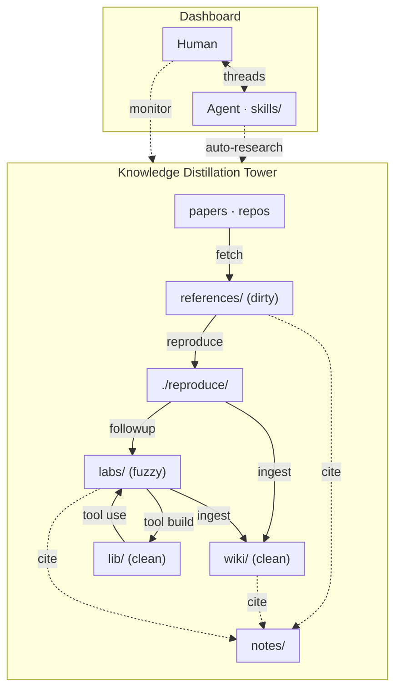

# AutoLab

**Summary**: AutoLab is an auto-research harness for a real lab: literature, experiments, compiled
knowledge, and optional shared code live as files you can see, sync, and hand to any agent. You
steer from a dashboard and Threads; the loop does the routine work.

**Sources**: [README](../../README.md)

**Last updated**: 2026-11-20

AutoLab is not another chat that “does science.” It is a **lab operating system**: a small set of
conventions and tools so agentic research stays inspectable, reproducible, and owned by you.

## The idea in one picture

AutoLab is mainly a **dashboard**: the interface where you stay in the loop with the agent
(via Threads), monitor the run, and steer when needed. The process itself is a **knowledge
distillation tower** — stepwise refinement from raw material (papers, repos) through dirty
(`references/`), fuzzy (`labs/`), and clean (`wiki/`, `lib/`) zones, ending in research products:
`notes/` and the shared package. Detail: [[system/distillation-tower|Distillation tower]].

## Why this, not another auto-research pile

Most harnesses optimize for a single agent session. AutoLab optimizes for a **lab that outlives
any one model or tool**:

- **Filesystem is the truth.** Catalogs, reports, wiki pages, and Threads are ordinary files. The
  dashboard is a view, not a second database.
- **Distillation, not accumulation.** Raw material stays in `references/` and `labs/`. Only claims
  worth keeping are compiled into the wiki; only proven APIs may enter `lib/`.
- **Syncable OS.** Skills and the dashboard ship as a versioned sync zone into domain labs. Your
  science stays in the project zone and is never overwritten by an OS update.
- **Human in the loop by design.** Routine work advances on its own; irreversible or judgment calls
  land in Threads for you to answer when you are ready.

## How you use it

1. **Open the lab.** `./run.sh start` — browse References, Labs, Wiki, Threads (Notes / API if you
   enabled them).
2. **Aim the loop.** Set a deliverable and priorities in Threads / `.auto-research/`; let
   `auto-research` tick through discover → fetch → reproduce → lab → ingest → optional promote.
3. **Read what thickened.** Lab `REPORT.md`s, wiki pages, and promotion records are the durable
   trail — not the chat transcript.

Agent operating instructions live in root [AGENTS.md](../../AGENTS.md); procedures live in
`skills/*/SKILL.md`. The human entry point is [README](../../README.md). This `system/` folder
is the **OS manual**: why the pieces exist and how a researcher should think about them.

## Manual chapters

- [[system/distillation-tower|Distillation tower]] — filter + floors; knowledge vs code
- [[system/dashboard-and-threads|Dashboard and Threads]] — why agentic work needs a control surface
- [[system/shared-package|Shared package]] — optional `lib/`, what belongs there

## Related pages

- [[../thesis|Project thesis]]
- [[../index|Wiki index]]
